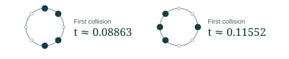

# How long before two zeros collide?

A question for Terence Tao · 5 November 2026

Your 2019 ACUE construction showed how a half-lattice of points can pass the same low-frequency tests as the eigenvalues of a random unitary matrix. We asked what happens if we let the points move. Treat them as roots of a polynomial, apply the same deterministic heat flow, and record the first time two roots meet.

**Four points already show what a list of distances forgets.** The filled dots below are two ways to occupy four of eight equally spaced sites. On either circle, the six distances between pairs, in lattice steps along the shorter arc, are **1, 1, 2, 3, 3, 4**. Yet the first collisions occur at different times. The list of distances loses track of which neighbors act on the same root.

**The same measurement separates the two ensembles as they grow.** For $N$ Haar unitary eigenvalues, the first collision typically occurs on the scale $N^{-8/3}$. On the ACUE half-lattice, every configuration stays collision-free up to at least $\pi^2/(8N^2)$. A time between those scales separates them. With probability tending to one a CUE polynomial has already had a collision, while every ACUE polynomial is still collision-free.

**The question for zeta is whether primes can detect an early collision.** Your work with Brad Rodgers gives a heat flow for zeta itself. To use the finite-model comparison there, we would need to control the pull of the surrounding zeros on a close pair. An estimate from primes for that local interaction is the step we are looking for.

## Five questions we would like to ask

1. Which feature of a close pair and its neighbors would you try to estimate first?
2. Could the explicit formula detect that feature using a short sum over primes?
3. How much of the surrounding zero configuration must a local heat-flow argument control?
4. Which family of function-field $L$-functions would give the cleanest first test?
5. Is there a simpler statistic of the zeros at time zero that retains the same distinction?

[Tao’s ACUE note](https://terrytao.wordpress.com/2019/05/08/the-alternative-hypothesis-for-unitary-matrices/) · [Rodgers–Tao heat flow](https://arxiv.org/abs/1801.05914) · [Exact four-point example](https://github.com/QingyunSun/Riemann-hypothesis-and-random-matrix/blob/4b96cd9d7324bf4c72f880182fcc7bba848227cd/research/counterexamples/pair-matched-flow/PAIR_MATCHED_HEAT_COUNTEREXAMPLES.md) · [Finite heat-flow calculation](https://github.com/QingyunSun/Riemann-hypothesis-and-random-matrix/blob/4b96cd9d7324bf4c72f880182fcc7bba848227cd/research/reports/yau_flow.md)
