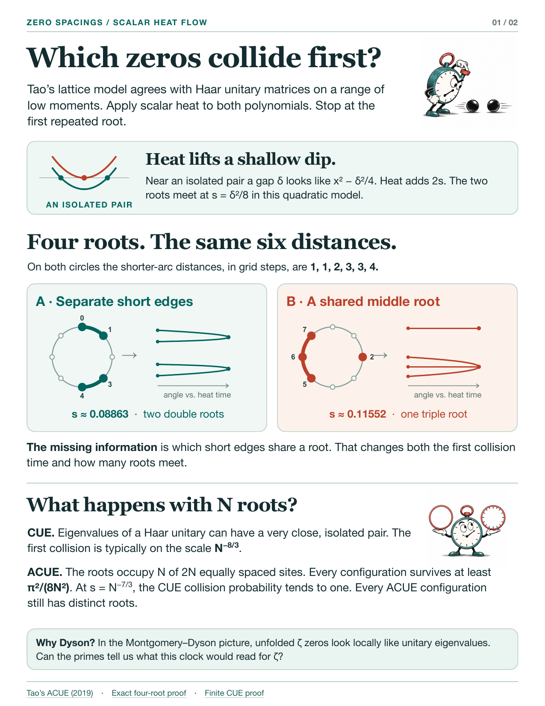
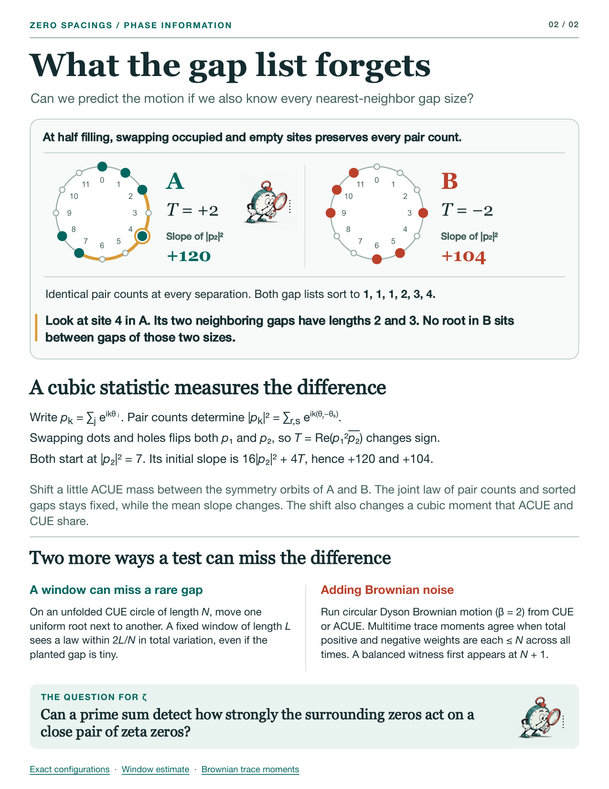

# Which zeros collide first?

[English comic](zero-collisions-en.pdf) · [中文漫画](zero-collisions-zh.pdf)

## The collision clock

## What the gap list forgets

## Checking the drawings

The two four-point configurations lie on the same eight-site grid. They illustrate loss of incidence in the distance list. CUE and ACUE enter separately in the large-ensemble comparison. Positive elapsed time in both cartoons means ordinary scalar heat acting on the real trigonometric polynomial, in the direction toward collision. The horizontal span of each trajectory plot ends at that configuration’s own first collision. Heights are angles after a common rotation, with separate angular origins and vertical scales in the unwrapped charts.

* In the first drawing the heat equation sends the model quadratic to $x^2-\delta^2/4+2s$. The approximation using just this quadratic for other roots needs isolation.
* At four points, the two green branches on each side follow the roots of the quadratic in $\cos x$ in the exact calculation. The red moving branches follow $\cos x=-e^{3s}/\sqrt2$. The repeated-root times are $0.0886279433267\ldots$ (two double roots) and $(\log 2)/6$ (one triple root). [Exact configuration proof](../../research/counterexamples/pair-matched-flow/PAIR_MATCHED_HEAT_COUNTEREXAMPLES.md)
* For six points, the cubic values are $+2$ and $-2$. In the positive elapsed-time convention the two initial derivatives of $|p_2|^2$ are $16\cdot7+4(2)=120$ and $16\cdot7+4(-2)=104$. The project’s checker reports the opposite sign for derivatives in the repulsive convention. [Exact checks](../../research/counterexamples/pair-matched-flow/PAIR_MATCHED_HEAT_CHECKS.json)
* The comparison at $s=N^{-7/3}$ uses a typical $N^{-8/3}$ first-collision time for Haar CUE and a deterministic $\pi^2/(8N^2)$ lower bound for every ACUE configuration. [Finite CUE argument](../../research/reports/dyson_round14.md) · [Gap comparison](../../research/reports/yau_flow.md)
* A proof for the actual zeta zeros would need an arithmetic estimate. Two related limitations are [the rare-defect window construction](../../research/counterexamples/pair-matched-flow/RARE_DEFECT_LOCAL_UNIVERSALITY.md) and [the shared frequency budget in circular Dyson Brownian motion](../../research/counterexamples/stochastic-protection/AGENT_STOCHASTIC_PROTECTION.md).

The original six- and four-point checker was rerun and its JSON agreed with the checked-in record. Numerical labels are rounded for display. The circular sites, curves, labels and formulae are typeset independently of the illustrations.

Stopwatch illustration credit and prompt

The three stopwatch vignettes were created with the built-in OpenAI ImageGen tool. Its production prompt follows.

Use case: scientific-educational cartoon. Create an ORIGINAL wordless editorial comic art plate, wide landscape aspect ratio 3:1, for a university math journal. A row of THREE separate spot illustrations of equal visual weight centered exactly at 1/6, 1/2 and 5/6 of the canvas width. Leave clear white empty vertical gutters near 1/3 and 2/3 so the illustrator's three vignettes can be placed separately on a printed comic page. All on pure WHITE flat background. Same distinctive recurring hero in every vignette: one small round antique analogue stopwatch with expressive eyebrows, dark teal metal case, vermilion ring/push button at the top, one black hand and simple ticks on the dial (absolutely NO digits), white face, little black-ink arms, feet and white gloves. Each vignette lively, narrative, dry New Yorker/European scientific comic wit; expressive and beautifully crafted pen and ink contours, restrained flat teal and warm red/coral ink, tiny loose drybrush hatch shadows. LEFT: side view of eager stopwatch leaning forward to time two smooth black billiard balls rolling toward each other from either side on a white tabletop, stopwatch holds one gloved finger on top button. MIDDLE: stopwatch referee with outstretched arms, one hand presenting an empty circular smooth racetrack hoop, other presenting a separate circular hoop with regular small ticks etched on the edge. RIGHT: stopwatch acting as a mathematician, using an oversized magnifying glass to study a short vertical row of tiny black dots, lean forward with curiosity. Keep forms spacious, separated and crisp, large faces. Each spot has no frame, no backdrop and no lettering or labels. No speech bubbles, no text, no numerals, no exclamation marks, no mathematical symbols, no signatures or watermarks. All three spots fully inside their own third with ample white padding on all four sides, nothing crossing between spots. Aim for ink-drawn character comedy suitable for an adult mathematician, not preschool clipart.

